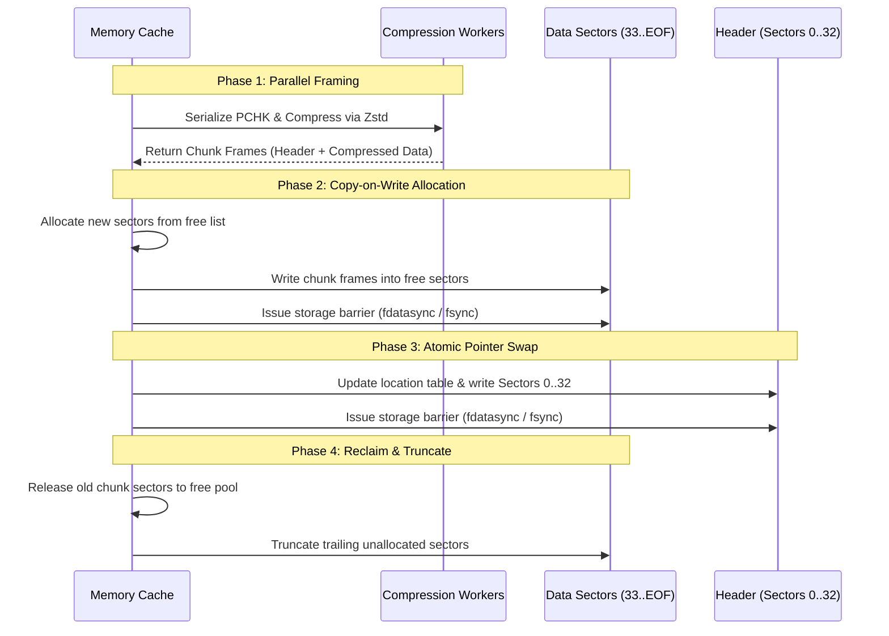

# The PUMP World Region & Chunk Storage Format Specification

**Document Version:** 1.0.0 (Release)  
**Specification Status:** Ratified Standard  
**Target Architecture:** Minecraft: Java Edition World Storage  
**Standard Authority:** Pumpkin Project / Pumpkin Contributors  
**License:** [MIT](LICENSE-MIT) OR [Apache-2.0](LICENSE-APACHE)  

---

## Abstract

This document defines the normative specification for the **PUMP** storage architecture, comprising the `.pump` region container format and the `PCHK` native chunk payload schema. PUMP specifies an optimized, atomic, crash-resilient, and computationally efficient binary world storage format designed to supersede legacy Anvil (`.mca`) region storage.

---

## Table of Contents

- [Chapter 1: Document Conventions & Conformance](#chapter-1-document-conventions--conformance)
  - [1.1 Normative Terminology](#11-normative-terminology)
  - [1.2 Definitions](#12-definitions)
  - [1.3 Conformance Requirements](#13-conformance-requirements)
- [Chapter 2: Numerical Representations & Coordinate Systems](#chapter-2-numerical-representations--coordinate-systems)
  - [2.1 Primitive Types & Byte Ordering](#21-primitive-types--byte-ordering)
  - [2.2 Coordinate Spaces & Partitioning](#22-coordinate-spaces--partitioning)
  - [2.3 Indexing Algorithms](#23-indexing-algorithms)
- [Chapter 3: Region Container Architecture (`.pump`)](#chapter-3-region-container-architecture-pump)
  - [3.1 Container Overview](#31-container-overview)
  - [3.2 Sector Subsystem](#32-sector-subsystem)
  - [3.3 Header Hierarchy](#33-header-hierarchy)
    - [3.3.1 Superblock (`PumpSuperblock`)](#331-superblock-pumpsuperblock)
    - [3.3.2 Chunk Location Table (`PumpChunkEntry`)](#332-chunk-location-table-pumpchunkentry)
  - [3.4 Sector Allocation and File Truncation](#34-sector-allocation-and-file-truncation)
- [Chapter 4: Compression Envelope & Frame Format](#chapter-4-compression-envelope--frame-format)
  - [4.1 Frame Header (`PumpChunkFrameHeader`)](#41-frame-header-pumpchunkframeheader)
  - [4.2 Compression Subsystem (Zstandard)](#42-compression-subsystem-zstandard)
  - [4.3 Integrity Verification (XXH64)](#43-integrity-verification-xxh64)
- [Chapter 5: Native Chunk Payload Schema (`PCHK` v1)](#chapter-5-native-chunk-payload-schema-pchk-v1)
  - [5.1 Chunk Payload Header (`PumpChunkHeader`)](#51-chunk-payload-header-pumpchunkheader)
  - [5.2 Packed Heightmaps](#52-packed-heightmaps)
  - [5.3 Sub-Chunk Section Stack](#53-sub-chunk-section-stack)
    - [5.3.1 Section Geometry](#531-section-geometry)
    - [5.3.2 Block State Palette and Data](#532-block-state-palette-and-data)
    - [5.3.3 Biome Palette and Data](#533-biome-palette-and-data)
    - [5.3.4 Nibble Lighting Arrays](#534-nibble-lighting-arrays)
  - [5.4 Scheduled Tick Queues](#54-scheduled-tick-queues)
  - [5.5 Block Entity Storage](#55-block-entity-storage)
  - [5.6 Custom Metadata Extension](#56-custom-metadata-extension)
- [Chapter 6: Transaction Lifecycle & Consistency Model](#chapter-6-transaction-lifecycle--consistency-model)
  - [6.1 Read Operation Sequence](#61-read-operation-sequence)
  - [6.2 Atomic Commit Write Protocol](#62-atomic-commit-write-protocol)
  - [6.3 Crash Consistency Guarantees](#63-crash-consistency-guarantees)
- [Chapter 7: Security Considerations & Resource Bounds](#chapter-7-security-considerations--resource-bounds)
  - [7.1 Denial of Service & Memory Exhaustion Bounds](#71-denial-of-service--memory-exhaustion-bounds)
  - [7.2 Structural Validation Invariants](#72-structural-validation-invariants)
- [Appendix A: Rust Data Type Bindings](#appendix-a-rust-data-type-bindings)
- [Appendix B: Anvil Compatibility and Transcoding](#appendix-b-anvil-compatibility-and-transcoding)

---

## Chapter 1: Document Conventions & Conformance

### 1.1 Normative Terminology

The key words **MUST**, **MUST NOT**, **REQUIRED**, **SHALL**, **SHALL NOT**, **SHOULD**, **SHOULD NOT**, **RECOMMENDED**, **NOT RECOMMENDED**, **MAY**, and **OPTIONAL** in this document are to be interpreted as described in BCP 14 [RFC 2119] [RFC 8174] when, and only when, they appear in all capitals, as shown here.

### 1.2 Definitions

* **Region Container:** A single host filesystem file containing metadata and packed chunk payloads for a bounded $32 \times 32$ horizontal chunk domain.
* **Superblock:** The initial 256-byte sector of a region container specifying format signatures, format version, and geographic coordinate alignment.
* **Chunk Location Table:** The fixed-size array of offset/length tuples defining the physical location and byte length of all indexed chunks within a region.
* **Sector:** The smallest atomic storage allocation unit in a `.pump` container, precisely fixed at $256$ bytes.
* **Slack Space (Internal Fragmentation):** Unused tail bytes between the final valid byte of an allocated record and the bounding sector edge.
* **Chunk Frame:** The contiguous byte stream encompassing the compression metadata header and the Zstandard-compressed payload.
* **Chunk Payload (`PCHK`):** The fully uncompressed, binary-serialized representation of an individual Minecraft chunk.
* **Section:** A cubic spatial volume of $16 \times 16 \times 16$ blocks.
* **Biome Cell:** A cubic spatial volume of $4 \times 4 \times 4$ blocks representing the minimum resolution for biome distribution.
* **Homogeneous:** A storage mode wherein all discrete elements within a section or biome volume share an identical single state identifier.
* **Valid Usage (VU):** Normative preconditions, invariants, and structural constraints that **SHALL** be satisfied by conforming implementations.

### 1.3 Conformance Requirements

A conforming implementation **SHALL** be classified into one or both of the following profiles:

1. **Conforming Reader:** An implementation capable of parsing, validating, and deserializing arbitrary valid PUMP containers and `PCHK` payloads while strictly rejecting non-conformant structures.
2. **Conforming Writer:** An implementation capable of generating valid PUMP containers and `PCHK` payloads that satisfy all Valid Usage clauses, adhere to transaction write barriers, and maintain format invariants.

---

## Chapter 2: Numerical Representations & Coordinate Systems

### 2.1 Primitive Types & Byte Ordering

Unless explicitly denoted otherwise, all multi-byte numerical fields in PUMP and `PCHK` **SHALL** be serialized in **Network Byte Order (Big-Endian)**.

| Type Identifier | Bit Width | Binary Representation | Value Range |
| :--- | :--- | :--- | :--- |
| `u8` | 8 | Unsigned integer | $[0, 255]$ |
| `i8` | 8 | Two's-complement signed integer | $[-128, 127]$ |
| `u16` | 16 | Unsigned integer (Big-Endian) | $[0, 65535]$ |
| `i16` | 16 | Two's-complement signed integer (Big-Endian) | $[-32768, 32767]$ |
| `u32` | 32 | Unsigned integer (Big-Endian) | $[0, 2^{32} - 1]$ |
| `i32` | 32 | Two's-complement signed integer (Big-Endian) | $[-2^{31}, 2^{31} - 1]$ |
| `u64` | 64 | Unsigned integer (Big-Endian) | $[0, 2^{64} - 1]$ |
| `i64` | 64 | Two's-complement signed integer (Big-Endian) | $[-2^{63}, 2^{63} - 1]$ |

Floating-point quantities, where referenced, **SHALL** conform to the IEEE 754-2008 standard (`f32`, `f64`).

### 2.2 Coordinate Spaces & Partitioning

* **World Block Space:** $\mathbf{P}_{\text{world}} = (X_{\text{world}}, Y_{\text{world}}, Z_{\text{world}}) \in \mathbb{Z}^3$.
* **Chunk Space:** $\mathbf{C} = (X_{\text{chunk}}, Z_{\text{chunk}}) \in \mathbb{Z}^2$, where:
  $$X_{\text{chunk}} = \lfloor X_{\text{world}} / 16 \rfloor, \quad Z_{\text{chunk}} = \lfloor Z_{\text{world}} / 16 \rfloor$$
* **Region Space:** $\mathbf{R} = (X_{\text{region}}, Z_{\text{region}}) \in \mathbb{Z}^2$, where:
  $$X_{\text{region}} = \lfloor X_{\text{chunk}} / 32 \rfloor = \lfloor X_{\text{world}} / 512 \rfloor$$
  $$Z_{\text{region}} = \lfloor Z_{\text{chunk}} / 32 \rfloor = \lfloor Z_{\text{world}} / 512 \rfloor$$

### 2.3 Indexing Algorithms

#### 2.3.1 Region Chunk Index

The linear chunk index $\mathcal{I}_{\text{chunk}} \in [0, 1023]$ of a chunk $(X_{\text{chunk}}, Z_{\text{chunk}})$ within its bounding region container **SHALL** be computed as:

$$\mathcal{I}_{\text{chunk}} = (Z_{\text{chunk}} \bmod 32) \times 32 + (X_{\text{chunk}} \bmod 32)$$

Where $\bmod$ denotes the standard Euclidean modulo operation:

$$(A \bmod 32) = A \ \& \ 31$$

#### 2.3.2 Section Block Index

Within a $16 \times 16 \times 16$ section, internal block coordinates $(u, v, w)$ such that $0 \le u, v, w < 16$ (representing relative $X, Y, Z$ respectively) **SHALL** be mapped to linear index $\mathcal{I}_{\text{block}} \in [0, 4095]$ using row-major $Y \to Z \to X$ ordering:

$$\mathcal{I}_{\text{block}} = (v \ll 8) \mid (w \ll 4) \mid u = v \times 256 + w \times 16 + u$$

#### 2.3.3 Section Biome Index

Within a $4 \times 4 \times 4$ biome cell volume, internal coordinates $(u, v, w)$ such that $0 \le u, v, w < 4$ **SHALL** be mapped to linear index $\mathcal{I}_{\text{biome}} \in [0, 63]$ using row-major $Y \to Z \to X$ ordering:

$$\mathcal{I}_{\text{biome}} = (v \ll 4) \mid (w \ll 2) \mid u = v \times 16 + w \times 4 + u$$

---

## Chapter 3: Region Container Architecture (`.pump`)

### 3.1 Container Overview

A PUMP region container file encapsulates data for up to $1024$ chunks.

* **File Naming Convention:** The container file name **SHALL** match the pattern:
  $$\text{r.}X_{\text{region}}\text{.}Z_{\text{region}}\text{.pump}$$
  Where $X_{\text{region}}$ and $Z_{\text{region}}$ are the decimal integer representations of the region coordinates.

### 3.2 Sector Subsystem

* The allocation granularity of the file **SHALL** be $S = 256$ bytes (`0x100`).
* All allocations, chunk record offsets, and structural alignments **SHALL** be integral multiples of $S$.
* The minimum number of sectors $N_{\text{sectors}}$ required to store a contiguous record of $L$ bytes **SHALL** be:
  $$N_{\text{sectors}}(L) = \left\lceil \frac{L}{S} \right\rceil = \left\lfloor \frac{L + S - 1}{S} \right\rfloor$$
* Unused trailing bytes within an allocated sector run $[L, N_{\text{sectors}}(L) \times S - 1]$ constitute slack space and **SHALL** be zero-filled ($0\text{x}00$) by conforming writers.

### 3.3 Header Hierarchy

The container header occupies the initial 33 sectors of the file ($33 \times 256 = 8,448$ bytes / `0x2100` bytes). Data sectors begin strictly at byte offset `0x2100` (Sector index 33).

```
Byte Offset:
0x0000 +---------------------------------------------------------------+
       | Sector 0: Superblock (256 bytes)                              |
0x0100 +---------------------------------------------------------------+
       | Sectors 1..32: Chunk Location Table                           |
       | 1024 entries * 8 bytes = 8,192 bytes                          |
0x2100 +---------------------------------------------------------------+
       | Sectors 33..EOF: Allocated Chunk Frame Sectors                |
       +---------------------------------------------------------------+
```

---

#### 3.3.1 Superblock (`PumpSuperblock`)

Sector 0 **SHALL** conform to the following layout:

```rust
#[repr(C, packed)]
pub struct PumpSuperblock {
    pub signature: [u8; 8],   // Offset 0x00: Magic and format version
    pub region_x: i32,        // Offset 0x08: Geographic region X
    pub region_z: i32,        // Offset 0x0C: Geographic region Z
    pub reserved: [u8; 240],  // Offset 0x10: Reserved padding bytes
}
```

##### Valid Usage (Implicit)
* `signature` **SHALL** be the exact 8-byte sequence:
  ```
  0x50 0x55 0x4D 0x50 0x00 0x00 0x00 0x01
  ('P'  'U'  'M'  'P'  \0   \0   \0   0x01)
  ```
* `region_x` **SHALL** match the coordinate $X_{\text{region}}$ embedded within the filesystem name.
* `region_z` **SHALL** match the coordinate $Z_{\text{region}}$ embedded within the filesystem name.
* `reserved` bytes **SHALL** be zero-initialized (`0x00`) on creation. Conforming readers **SHALL** ignore the contents of `reserved` to permit forward-compatible extension flags.

---

#### 3.3.2 Chunk Location Table (`PumpChunkEntry`)

Sectors 1 through 32 encompass an array of $1024$ contiguous 8-byte descriptors:

```rust
#[repr(C, packed)]
pub struct PumpChunkEntry {
    pub sector_offset: u32,   // Sector index of chunk record start
    pub byte_length: u32,     // Exact unpadded byte length of chunk frame
}
```

##### Valid Usage (Implicit)
* For any index $\mathcal{I} \in [0, 1023]$:
  * If the chunk at index $\mathcal{I}$ is non-existent, both `sector_offset` and `byte_length` **SHALL** be zero (`0`).
  * If the chunk at index $\mathcal{I}$ is allocated:
    * `sector_offset` **SHALL** be greater than or equal to `33` (`0x21`).
    * `byte_length` **SHALL** be greater than `0`.
    * The physical byte range:
      $$[\text{sector\_offset} \times 256, \ \text{sector\_offset} \times 256 + \text{byte\_length})$$
      **SHALL** be strictly contained within the bounds of the host container file $[0, \text{FileSize})$.
  * Conforming writers **SHALL NOT** emit overlapping sector intervals for distinct chunk entries.

---

### 3.4 Sector Allocation and File Truncation

* **Allocation Map:** Conforming implementations **SHOULD** maintain a dynamic sector occupancy bitmap in memory to track allocated sectors.
* **Sector Allocation Strategy:** Writers **SHALL** locate a contiguous run of free sectors of length $N = N_{\text{sectors}}(\text{byte\_length})$. If no internal gap satisfies $N$, the run **SHALL** be appended to the current maximum allocated sector.
* **Tail Truncation:** If sectors freed during a modification sequence encompass the end of the file, conforming writers **SHOULD** issue a filesystem truncation (`ftruncate`, `SetEndOfFile`) reducing the host file length to the highest active sector boundary.

---

## Chapter 4: Compression Envelope & Frame Format

Every populated chunk entry references a discrete Chunk Frame Record beginning at byte offset $\text{sector\_offset} \times 256$.

### 4.1 Frame Header (`PumpChunkFrameHeader`)

The framing metadata header is fixed at **12 bytes**:

```rust
#[repr(C, packed)]
pub struct PumpChunkFrameHeader {
    pub uncompressed_len: u32, // Byte length of decompressed payload
    pub checksum: u64,         // XXH64 checksum of decompressed payload
}
```

| Field Name | Type | Offset | Description |
| :--- | :--- | :--- | :--- |
| `uncompressed_len` | `u32` | `0x00` | Uncompressed payload size in bytes. |
| `checksum` | `u64` | `0x04` | 64-bit xxHash (seed 0) computed over decompressed payload. |
| `compressed_data` | `[u8]` | `0x0C` | Raw Zstandard frame payload spanning `byte_length - 12` bytes. |

##### Valid Usage (Implicit)
* `uncompressed_len` **SHALL NOT** exceed $67,108,864$ bytes ($64\text{ MiB}$).
* `byte_length` from the chunk location table **SHALL** be strictly greater than $12$.
* The decompressed payload output byte length **SHALL** exactly equal `uncompressed_len`.
* The computed checksum:
  $$\text{XXH64}(\text{decompressed\_payload}, 0)$$
  **SHALL** bitwise match `checksum`.

### 4.2 Compression Subsystem (Zstandard)

* The compressed data stream **SHALL** conform to the Zstandard Compression Format [RFC 8878].
* Conforming readers **SHALL** initialize a streaming or block decompression context supporting window sizes up to the single-chunk threshold ($64\text{ MiB}$).

### 4.3 Integrity Verification (XXH64)

* The integrity hash **SHALL** be evaluated using the 64-bit algorithm of xxHash (XXH64) as specified by Yann Collet.
* The seed parameter passed to the hash invocation **SHALL** be zero (`0`).
* If verification fails, the reader **SHALL** abort deserialization and report a corrupted chunk fault.

---

## Chapter 5: Native Chunk Payload Schema (`PCHK` v1)

Upon decompression, the payload represents a serialized native chunk stream adhering to schema version 1.

```
Payload Binary Stream Layout:
+-------------------------------------------------------------+
| PumpChunkHeader (31 bytes)                                 |
+-------------------------------------------------------------+
| Packed Heightmaps (0 to 3 * 296 bytes)                      |
+-------------------------------------------------------------+
| Section Count (u16, 2 bytes)                                |
+-------------------------------------------------------------+
| Serialized Sections Array (Variable)                        |
| - Block Palette + Block States                              |
| - Biome Palette + Biome States                              |
| - Lighting Arrays                                           |
+-------------------------------------------------------------+
| Scheduled Block Ticks Array (u32 count + entries)           |
+-------------------------------------------------------------+
| Scheduled Fluid Ticks Array (u32 count + entries)           |
+-------------------------------------------------------------+
| Block Entities (u32 count + length-prefixed NBTs)           |
+-------------------------------------------------------------+
| Custom Auxiliary Data (optional, length-prefixed NBT)       |
+-------------------------------------------------------------+
```

---

### 5.1 Chunk Payload Header (`PumpChunkHeader`)

```rust
#[repr(C, packed)]
pub struct PumpChunkHeader {
    pub magic: [u8; 4],        // Offset 0x00: ASCII "PCHK"
    pub version: u8,           // Offset 0x04: Schema version (Must be 1)
    pub data_version: i32,     // Offset 0x05: Minecraft World Data Version
    pub x: i32,                // Offset 0x09: Chunk coordinate X
    pub z: i32,                // Offset 0x0D: Chunk coordinate Z
    pub min_section_y: i32,    // Offset 0x11: Lowest section vertical index Y
    pub status: u8,            // Offset 0x15: Chunk generation lifecycle state
    pub flags: u8,             // Offset 0x16: Chunk capability bitfield flags
    pub inhabited_time: u64,   // Offset 0x17: Total cumulative inhabited ticks
}
```

##### Valid Usage (Implicit)
* `magic` **SHALL** be the 4-byte sequence `b"PCHK"` (`0x50, 0x43, 0x48, 0x4B`).
* `version` **SHALL** be `1`.
* `x` and `z` **SHALL** match the coordinates specified by the region geographic location and table index:
  $$x = X_{\text{region}} \times 32 + (\mathcal{I}_{\text{chunk}} \ \& \ 31)$$
  $$z = Z_{\text{region}} \times 32 + (\mathcal{I}_{\text{chunk}} \gg 5)$$
* `status` **SHALL** be an integer in the range $[0, 9]$, mapped according to the following enumeration:

| Value | Status Identifier | Description |
| :--- | :--- | :--- |
| `0` | `Empty` | Chunk structure is unallocated. |
| `1` | `StructureStarts` | Structure boundary origins generated. |
| `2` | `StructureReferences` | Structure cross-references propagated. |
| `3` | `Biomes` | Biome distribution generated. |
| `4` | `Terrain` | Raw noise/terrain elevation surfaces formed. |
| `5` | `Features` | World decoration features populated. |
| `6` | `InitializeLight` | Light propagation state initialized. |
| `7` | `Light` | Section lighting solved. |
| `8` | `Spawn` | Entity/mob spawning constraints satisfied. |
| `9` | `Full` | Chunk is completely generated. |

##### Chunk Flags Bitmask Definition

| Bit Index | Mask | Identifier | Semantics |
| :--- | :--- | :--- | :--- |
| Bit 0 | `0x01` | `LIGHT_CORRECT` | Chunk lighting is fully solved and validated. |
| Bit 1 | `0x02` | `HAS_WORLD_SURFACE` | World surface heightmap is present in stream. |
| Bit 2 | `0x04` | `HAS_MOTION_BLOCKING` | Motion blocking heightmap is present in stream. |
| Bit 3 | `0x08` | `HAS_MOTION_BLOCKING_NO_LEAVES` | Motion blocking (no leaves) heightmap is present. |
| Bit 4 | `0x10` | `HAS_CUSTOM_DATA` | Trailing custom NBT data block is present. |
| Bits 5..7| `0xE0` | `RESERVED` | **SHALL** be zero (`0`). |

---

### 5.2 Packed Heightmaps

If any heightmap flag bits (`0x02`, `0x04`, `0x08`) are asserted, the corresponding heightmap arrays **SHALL** appear immediately following the `PumpChunkHeader` in ascending bit order:

1. `WorldSurface` (if `flags & 0x02 != 0`)
2. `MotionBlocking` (if `flags & 0x04 != 0`)
3. `MotionBlockingNoLeaves` (if `flags & 0x08 != 0`)

* Each heightmap consists of exactly **37 signed 64-bit integers** (`[i64; 37]`, 296 bytes).
* The 37 64-bit integers represent 256 9-bit elevation values packed continuously:
  $$\text{Total Bits} = 256 \times 9 = 2304 \text{ bits} = 36 \times 64 \text{ bits}$$
  The array length is padded to 37 entries to maintain direct parity with Minecraft's heightmap structures.

---

### 5.3 Sub-Chunk Section Stack

Directly follows the heightmaps:

```rust
pub section_count: u16; // Number of vertical sections (Max: 256)
```

Sections are serialized in strictly ascending vertical order:

$$Y \in [\text{min\_section\_y}, \ \text{min\_section\_y} + \text{section\_count} - 1]$$

#### 5.3.1 Section Geometry

Each section represents a $16 \times 16 \times 16$ block grid ($4096$ block positions) and a $4 \times 4 \times 4$ biome grid ($64$ biome positions).

---

#### 5.3.2 Block State Palette and Data

The block states for each section are serialized using one of three modes, denoted by a leading `u8 mode` tag.

##### Mode 0: Homogeneous Palette

Used when all 4096 blocks within the section share a single state.

```rust
#[repr(C, packed)]
pub struct PumpBlockHomogeneous {
    pub mode: u8,            // Must be 0
    pub block_state_id: u16, // Global Minecraft Block State ID
}
```

##### Mode 1: Indexed Palette

Used when the section contains between 1 and 256 unique block states ($1 \le N \le 256$).

```rust
#[repr(C, packed)]
pub struct PumpBlockPaletteEntry {
    pub block_state_id: u16, // Global Minecraft Block State ID
    pub block_count: u16,    // Frequency count in section
}

pub struct PumpBlockIndexed {
    pub mode: u8,            // Must be 1
    pub palette_len: u16,    // Number of unique states (N in 1..=256)
    pub palette: Vec<PumpBlockPaletteEntry>, // Length: palette_len
    pub indices: [u8; 4096], // Indices into palette array, ordered (Y, Z, X)
}
```

##### Valid Usage (Implicit)
* `palette_len` **SHALL** be in the range $[1, 256]$.
* Every index in `indices` **SHALL** be strictly less than `palette_len`.
* The sum of all `block_count` fields in `palette` **SHALL** equal $4096$.

##### Mode 2: Dense Storage

Used when the section contains more than 256 distinct block states.

```rust
pub struct PumpBlockDense {
    pub mode: u8,            // Must be 2
    pub states: [u16; 4096], // Direct global Block State IDs, ordered (Y, Z, X)
}
```

---

#### 5.3.3 Biome Palette and Data

Immediately follows the section's block data. Biomes are sampled on a $4 \times 4 \times 4$ grid ($64$ cells).

##### Mode 0: Homogeneous Biome

```rust
#[repr(C, packed)]
pub struct PumpBiomeHomogeneous {
    pub mode: u8,     // Must be 0
    pub biome_id: u8, // Global Biome Registry ID
}
```

##### Mode 1: Heterogeneous Biome Palette

```rust
#[repr(C, packed)]
pub struct PumpBiomePaletteEntry {
    pub biome_id: u8,     // Global Biome Registry ID
    pub biome_count: u16, // Frequency count in section
}

pub struct PumpBiomeHeterogeneous {
    pub mode: u8,         // Must be 1
    pub palette_len: u8,  // Number of unique biomes (M in 1..=64)
    pub palette: Vec<PumpBiomePaletteEntry>, // Length: palette_len
    pub biomes: [u8; 64], // Direct biome IDs, ordered (Y, Z, X)
}
```

---

#### 5.3.4 Nibble Lighting Arrays

Immediately follows the section's biome data:

```rust
pub light_flags: u8;
```

* **Bit 0 (`0x01`):** `HAS_BLOCK_LIGHT`
* **Bit 1 (`0x02`):** `HAS_SKY_LIGHT`

If `HAS_BLOCK_LIGHT` is asserted, exactly **2048 bytes** (`[u8; 2048]`) follow, representing 4096 4-bit nibbles for block light levels.

If `HAS_SKY_LIGHT` is asserted, exactly **2048 bytes** (`[u8; 2048]`) follow, representing 4096 4-bit nibbles for sky light levels.

Nibbles are packed such that:
* Low nibble (`byte & 0x0F`): Even block linear index $2k$.
* High nibble (`(byte >> 4) & 0x0F`): Odd block linear index $2k + 1$.

If a flag bit is not set, all lighting levels for that category are implicitly zero.

---

### 5.4 Scheduled Tick Queues

Following all section definitions, scheduled ticks are serialized as two sequential length-prefixed arrays:

#### 5.4.1 Scheduled Block Ticks

```rust
pub block_tick_count: u32; // Maximum: 65,536
```

Followed by `block_tick_count` records of 16 bytes:

```rust
#[repr(C, packed)]
pub struct PumpScheduledTick {
    pub x: i32,         // Absolute World Coordinate X
    pub y: i32,         // Absolute World Coordinate Y
    pub z: i32,         // Absolute World Coordinate Z
    pub delay: u8,      // Remaining execution tick delay
    pub priority: i8,   // Priority level (-3 to 3)
    pub target_id: u16, // Numeric Block or Fluid ID
}
```

#### 5.4.2 Scheduled Fluid Ticks

```rust
pub fluid_tick_count: u32; // Maximum: 65,536
```

Followed by `fluid_tick_count` records of 16 bytes using the `PumpScheduledTick` structure layout.

---

### 5.5 Block Entity Storage

Following scheduled fluid ticks, block entities are stored as an array of length-prefixed unnamed Java NBT Compound tags:

```rust
pub block_entity_count: u32; // Maximum: 65,536
```

Followed by `block_entity_count` entries of:

```rust
pub struct PumpBlockEntityEntry {
    pub byte_length: u32,     // Length of NBT payload in bytes
    pub nbt_payload: Vec<u8>, // Unnamed TAG_Compound byte stream
}
```

##### Valid Usage (Implicit)
* `nbt_payload` **SHALL** parse as a valid unnamed `TAG_Compound`.
* The parsed compound **SHALL** contain integer coordinate tags `"x"`, `"y"`, and `"z"`, and a string identifier tag `"id"`.

---

### 5.6 Custom Metadata Extension

If bit 4 (`0x10`) of `PumpChunkHeader.flags` is asserted, the end of the stream **SHALL** contain an arbitrary auxiliary NBT data block:

```rust
pub custom_data_length: u32;   // Length of custom NBT payload
pub custom_data_nbt: Vec<u8>,  // Unnamed TAG_Compound payload
```

Conforming readers **SHALL** preserve this compound across transcoding and write cycles to avoid stripping plugin or mod metadata.

---

## Chapter 6: Transaction Lifecycle & Consistency Model

### 6.1 Read Operation Sequence

To perform a conformant chunk read:

1. Read Sector 0 (`PumpSuperblock`). Verify `signature == "PUMP\0\0\0\1"`.
2. Compute $\mathcal{I}_{\text{chunk}} = (Z_{\text{chunk}} \ \& \ 31) \times 32 + (X_{\text{chunk}} \ \& \ 31)$.
3. Seek to `0x0100 + (index * 8)`. Read `PumpChunkEntry`.
4. If `sector_offset == 0` or `byte_length == 0`, chunk is unallocated; terminate with `None`.
5. Seek to `sector_offset * 256`. Read `byte_length` bytes into buffer $\mathcal{B}$.
6. Parse 12-byte `PumpChunkFrameHeader`. Verify `uncompressed_len <= 64 MiB`.
7. Decompress payload using Zstandard. Verify decompressed size matches `uncompressed_len`.
8. Compute $\text{XXH64}(\text{decompressed}, 0)$. Verify equality with header `checksum`.
9. Parse `PumpChunkHeader` and trailing section arrays.

---

### 6.2 Atomic Commit Write Protocol

To ensure resistance to torn writes without external journaling files, conforming writers **SHALL** execute writes according to the following strict phased sequence:



1. **Phase 1 (Preparation):** Serialize modified chunks to `PCHK` format. Execute Zstandard compression and compute XXH64 checksums.
2. **Phase 2 (Allocation & Data Flush):**
   * Search sector occupancy bitmap for contiguous free sectors matching $N_{\text{sectors}}(\text{byte\_length})$.
   * Write padded chunk frames into newly assigned sectors.
   * **Write Barrier 1:** Execute an explicit hardware storage flush (`fdatasync` / `FlushFileBuffers`). Chunk data is guaranteed to reside on non-volatile media before advancing.
3. **Phase 3 (Atomic Header Commit):**
   * Update the in-memory `PumpChunkEntry` records for all committed chunks.
   * Write the complete 33-sector header (`0x0000..0x2100`) to disk.
   * **Write Barrier 2:** Execute a second storage flush. The header commit is now durable.
4. **Phase 4 (Reclamation & Truncation):**
   * Mark previously occupied sector runs as free in the occupancy bitmap.
   * If freed sectors are located at the end of the file, issue a truncation call to shrink the container.

---

### 6.3 Crash Consistency Guarantees

* **Power Failure during Phase 2:** The file header remains unmodified on disk, continuing to address the pre-existing, valid chunk sector locations. The newly written sectors are orphaned and will be reclaimed automatically on subsequent open.
* **Power Failure during Phase 3:** Because Phase 2 was flushed to storage, an atomic sector write will either leave the old location table or update to the new location table. Under standard POSIX/NTFS sector write semantics, no torn chunk frames can be visible.
* At no point does a valid chunk pointer reference uncommitted or partially written storage.

---

## Chapter 7: Security Considerations & Resource Bounds

### 7.1 Denial of Service & Memory Exhaustion Bounds

Conforming implementations **SHALL** enforce the following structural bounds during deserialization to guard against malicious inputs or damaged files:

| Identifier | Maximum Upper Bound | Action on Violation |
| :--- | :--- | :--- |
| `PUMP_MAX_DECOMPRESSED_CHUNK_BYTES` | $67,108,864$ ($64\text{ MiB}$) | Immediately reject frame prior to decompression. |
| `PUMP_MAX_SECTIONS` | $256$ sections | Reject payload; abort parsing. |
| `PUMP_MAX_TICKS` | $65,536$ ticks | Reject payload; abort parsing. |
| `PUMP_MAX_BLOCK_ENTITIES` | $65,536$ entities | Reject payload; abort parsing. |

### 7.2 Structural Validation Invariants

1. **Minimum Frame Size:** A chunk entry with `byte_length < 12` is invalid.
2. **Sector Index Floor:** A non-zero `sector_offset` strictly less than `33` **SHALL** be treated as a fatal corrupt container header.
3. **File Span Check:** The interval $[\text{sector\_offset} \times 256, \ \text{sector\_offset} \times 256 + \text{byte\_length}]$ **SHALL NOT** exceed the actual physical file size.

---

## Appendix A: Rust Data Type Bindings

The following Rust declarations specify the binary layout and constants for the PUMP container and `PCHK` chunk schema:

```rust
pub const PUMP_SECTOR_SIZE: usize = 256;
pub const PUMP_HEADER_SECTORS: usize = 33;
pub const PUMP_HEADER_BYTES: usize = PUMP_HEADER_SECTORS * PUMP_SECTOR_SIZE;
pub const PUMP_CHUNK_COUNT: usize = 1024;
pub const PUMP_MAX_DECOMPRESSED_CHUNK_BYTES: usize = 64 * 1024 * 1024;
pub const PUMP_SIGNATURE: [u8; 8] = *b"PUMP\x00\x00\x00\x01";
pub const PUMP_CHUNK_MAGIC: [u8; 4] = *b"PCHK";

/// Sector 0: Container Superblock (256 bytes)
#[repr(C, packed)]
#[derive(Clone, Copy, Debug, PartialEq, Eq)]
pub struct PumpSuperblock {
    pub signature: [u8; 8],
    pub region_x: i32,
    pub region_z: i32,
    pub reserved: [u8; 240],
}

/// Sectors 1..32: Chunk Location Table Entry (8 bytes)
#[repr(C, packed)]
#[derive(Clone, Copy, Debug, PartialEq, Eq)]
pub struct PumpChunkEntry {
    pub sector_offset: u32,
    pub byte_length: u32,
}

/// Chunk Compression Framing Header (12 bytes)
#[repr(C, packed)]
#[derive(Clone, Copy, Debug, PartialEq, Eq)]
pub struct PumpChunkFrameHeader {
    pub uncompressed_len: u32,
    pub checksum: u64,
}

/// Uncompressed Chunk Payload Header (31 bytes)
#[repr(C, packed)]
#[derive(Clone, Copy, Debug, PartialEq, Eq)]
pub struct PumpChunkHeader {
    pub magic: [u8; 4],
    pub version: u8,
    pub data_version: i32,
    pub x: i32,
    pub z: i32,
    pub min_section_y: i32,
    pub status: u8,
    pub flags: u8,
    pub inhabited_time: u64,
}

/// Scheduled Block or Fluid Tick Record (16 bytes)
#[repr(C, packed)]
#[derive(Clone, Copy, Debug, PartialEq, Eq)]
pub struct PumpScheduledTick {
    pub x: i32,
    pub y: i32,
    pub z: i32,
    pub delay: u8,
    pub priority: i8,
    pub target_id: u16,
}
```

---

## Appendix B: Anvil Compatibility and Transcoding

Conversion between Anvil (`.mca`) and PUMP (`.pump`) **SHALL** preserve the following equivalences:

1. **Section Palette Translation:**
   * Anvil's string-based block state compound definitions (`Name` + `Properties`) map directly to the numeric `block_state_id: u16` defined in the server's global state registry for the corresponding `data_version`.
   * Unindexed/dense Anvil sub-chunks are packed into Mode 1 (Indexed) or Mode 2 (Dense) PUMP sections.
2. **Biome Preservation:**
   * Anvil biome palette strings map to 8-bit numeric IDs.
3. **Lighting Data:**
   * Nibble arrays in Anvil sub-chunks (`BlockLight`, `SkyLight`) map directly to the 2048-byte nibble arrays in PUMP.
4. **Auxiliary Root Data:**
   * Non-standard compound tags in Anvil chunks (such as custom mod parameters or Forge capabilities) that have no counterpart in `PCHK` **SHALL** be preserved in the `custom_data` NBT compound tag.
